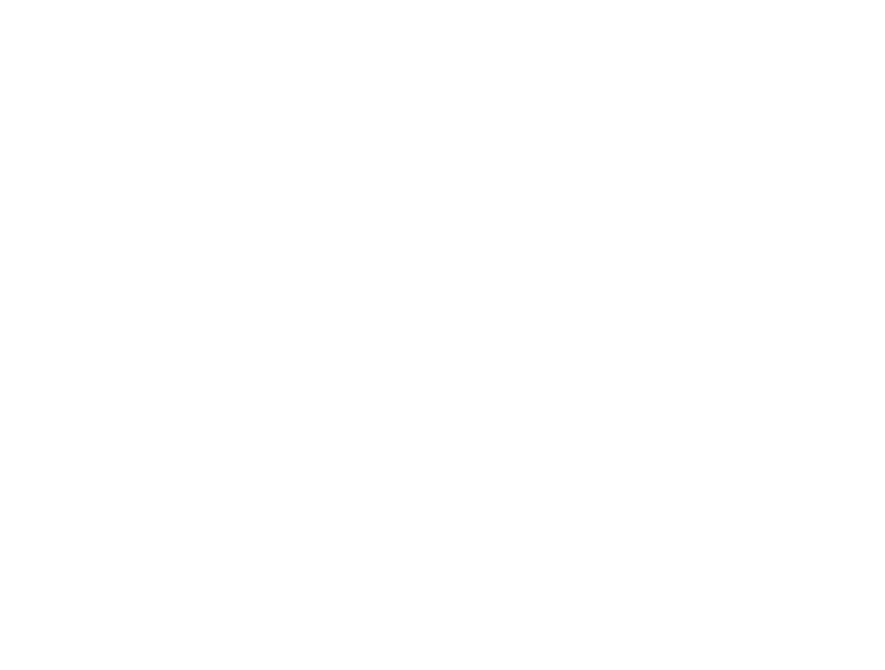

# Categorical Encoding and Data Leakage with Naive Bayes

How much does the choice of categorical encoder matter for a Naive Bayes classifier, and what happens when the encoder is fitted **before** the train/test split?

This project compares three encoder–classifier pairings on a 70k-row health survey dataset and shows how a target-based encoder can inflate test accuracy from **0.73 to 0.99** through data leakage.



## Key findings

| Encoder → Classifier | Encoder fitted before split | Encoder fitted after split |
|---|---|---|
| OneHotEncoder → MultinomialNB | 0.7333 | 0.7333 |
| OrdinalEncoder → CategoricalNB | 0.7333 | 0.7333 |
| CatBoostEncoder → GaussianNB | **0.9901** | 0.7282 |

*Mean accuracy over 20 random 50/50 train/test splits.*

- **Target encoding leaks labels.** CatBoostEncoder replaces each category with a smoothed mean of the target. When it is fitted on the full dataset, the test labels end up inside the features, and accuracy jumps to 0.99. Fitting it on the training set only brings it back to 0.73.
- **Row order amplifies the leak.** The data file is sorted by class (the label changes only once along the file), and CatBoost computes its ordered target statistics following row order. This makes the leaked signal especially strong.
- **Label-free encoders are unaffected.** One-hot and ordinal encoding do not use the target, so fitting them before or after the split gives the same result.
- **MultinomialNB on one-hot data matches CategoricalNB.** Both models are built on the same per-category counts within each class, so they produce identical predictions on this dataset.

**Takeaway:** fit every preprocessing step on the training data only, and treat suspiciously high scores as a signal to check for leakage.

## Data

`data/diabetes_70k.csv`: 70,692 respondents, 21 categorical/ordinal features (blood pressure, cholesterol, BMI, smoking, physical activity, general health, age group, income, etc.) and a binary target `class` (diabetes / no diabetes). The two classes are perfectly balanced (35,346 each), so accuracy is a reasonable metric.

The data comes from the CDC Behavioral Risk Factor Surveillance System (BRFSS) 2015, in the balanced version published on Kaggle as the *Diabetes Health Indicators Dataset*.

## Method

1. Treat all 21 features as categorical.
2. **Leaky setup:** fit each encoder on the full dataset, then split 50/50 and train the classifier.
3. **Correct setup:** split 50/50 first, fit each encoder on the training set only, then transform both sets.
4. Repeat each setup over 20 random seeds and report mean accuracy.

Implementation details:
- `CategoricalNB(min_categories=...)` and `OrdinalEncoder(categories=...)` handle rare BMI values that can be missing from a training split.
- `OneHotEncoder(handle_unknown='ignore')` handles categories that appear only in the test set.
- `CatBoostEncoder(cols=...)` is given the column list explicitly, since integer columns are not encoded by default.

## Repository structure

```
.
├── README.md
├── requirements.txt
├── naive_bayes_encoding_leakage.ipynb
├── data/
│   └── diabetes_70k.csv
└── images/
    └── accuracy_comparison.png
```

## How to run

```bash
git clone https://github.com/DavideCru/naive-bayes-encoding-leakage.git
cd naive-bayes-encoding-leakage
pip install -r requirements.txt
jupyter notebook naive_bayes_encoding_leakage.ipynb
```

## Tools

Python, pandas, NumPy, scikit-learn, category_encoders, Matplotlib.

## Author

Davide Cruciani, MSc Statistical Data Science, University College Dublin
